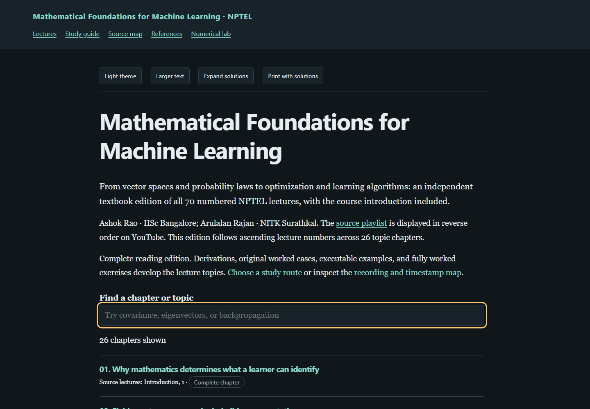

# Mathematical Foundations for Machine Learning — a textbook rewrite

**[Read the live textbook](https://az9713.github.io/nptel-mathematical-foundations-for-machine-learning-notes/)**

[](https://az9713.github.io/nptel-mathematical-foundations-for-machine-learning-notes/)

An independent, transcript-grounded edition of the NPTEL course by **Ashok Rao
(IISc Bangalore)** and **Arulalan Rajan (NITK Surathkal)**. The
[official syllabus](https://archive.nptel.ac.in/content/syllabus_pdf/106108702.pdf)
identifies the course and its mathematical scope. The
[YouTube playlist](https://www.youtube.com/playlist?list=PLgMDNELGJ1CYPJS6m_ygxb4KtHYxh1HjR)
provides the chronological topic sequence and timestamp anchors.

All **70 numbered lectures**, including the consolidation and final-summary
recordings, are covered in **26 topic chapters**. The introduction video is also
included, accounting for **all 71 playlist entries**. YouTube displays the
playlist in reverse order; this edition follows ascending lecture numbers.

The book contains approximately **63,000 words excluding code**, **156 problems
with fully worked solutions**, **26 executed Python examples**, and a
downloadable numerical laboratory with **five constructed studies**. Its
explanations, derivations, examples, code, and exercises are independently
authored rather than a verbatim transcript.

Explore the [study guide](https://az9713.github.io/nptel-mathematical-foundations-for-machine-learning-notes/book-overview.html),
[recording and timestamp map](https://az9713.github.io/nptel-mathematical-foundations-for-machine-learning-notes/source-map.html),
[references](https://az9713.github.io/nptel-mathematical-foundations-for-machine-learning-notes/references.html),
and [numerical laboratory](https://az9713.github.io/nptel-mathematical-foundations-for-machine-learning-notes/numerical-lab.html).

## What the edition develops

- **Linear algebra:** fields, vector spaces, bases, linear maps, eigenstructure,
  inner products, projection, symmetric matrices, least squares, principal
  components, singular values, and separating margins.
- **Probability and statistics:** events, conditioning, Bayes' rule, measures,
  random variables, distributions, moments, joint laws, covariance, conditional
  expectation, concentration, the central limit theorem, and sample geometry.
- **Calculus and learning:** derivatives, Taylor approximation, gradients,
  Jacobians, Hessians, matrix differentials, constrained optimization, gradient
  algorithms, perceptrons, multilayer networks, backpropagation, classification,
  clustering, and linear and logistic regression.

Each chapter states assumptions, defines symbols locally, develops central
arguments, checks a concrete construction, and identifies failure cases.
Primary-author references are integrated beside the claims they support.
Timestamp links locate related lecture discussion; they do not imply that every
added proof, example, or correction was presented in the recording.

## Read and run locally

Download the repository ZIP, extract it, and open `index.html`. The shared NPTEL
reader includes dark/light themes, adjustable text size, chapter search,
previous/next navigation, a contents panel, code-copy controls, expandable
solutions, and printing with solutions. CSS, JavaScript, and MathJax are bundled
for offline use. Recordings and external references require a connection.

To rebuild and check the edition:

```sh
python -m pip install -r requirements.txt
python tools/build_book.py
python tools/check_chapter_code.py
python numerical_lab.py
python tools/validate_books.py --browser
```

Browser checks use Python Playwright and an installed Chromium browser. If
needed, run `python -m playwright install chromium`. The checker can also use a
standard Windows Chrome installation. Numerical examples use NumPy and the
Python standard library. Run a chapter's listings in order in a fresh process.

## Sources and evidence

Full source text was read sequentially for every assigned recording. Seventy
recordings provide English caption tracks. **Lecture 55 has no English YouTube
captions** and uses a full-audio local Whisper `small.en` transcription. Publisher
caption labels, including “NPTEL Verified,” do not establish human authorship or
perfect mathematical accuracy. Caption ambiguities are resolved by explicit
mathematical arguments and inspected references; an unconfirmed caption
discrepancy is not attributed to an instructor.

Independent scientific cross-review accepted all 26 final chapter bodies with
zero blocking findings after repairs. Repairing authors do not accept their own
rewrites. Exact body digests preserve acceptance through reader wrapping. The
study guide, references page, and laboratory received a separate independent
review. These are AI-assisted editorial checks, not human expert certification
or formal verification of every statement.

A second independent round reread all 26 manuscripts and all 156 worked
solutions, checked lecture-topic ledgers against targeted caption passages,
and compared explanatory development with the Stanford and NPTEL exemplars.
It resolved ten localized findings across eight chapters, including operation
terminology, theorem hypotheses, and degenerate prediction cases. Every repair
was independently rechecked against its exact new body digest. This round did
not repeat the original complete transcript reading or add audiovisual review.
The [first review record](editorial-review-round-1.json) is retained alongside
the current review summary.

All 26 chapter programs executed successfully and matched their displayed
output. The laboratory also ran successfully. Those checks reproduce teaching
constructions; they do not establish real-world predictive performance.
Desktop/mobile offline checks, clean-export reproduction, and live publication
checks retain separate records and scopes.

See the [workflow](WORKFLOW.md), [source inventory](source-manifest.json),
[source checks](source-validation-summary.json),
[editorial review](editorial-review-summary.json),
[supporting-material review](course-review.json),
[code checks](chapter-code-validation.json),
[reader checks](reader-validation.json), [package checks](package-validation.json),
[clean-export checks](source-free-validation.json), and
[publication checks](publication-validation.json).

Comprehensive audiovisual review and human accessibility certification are not
claimed. Two longer caption intervals received bounded local audio-recognition
and amplitude checks; those checks do not establish complete visual coverage.

The public package contains the rewritten notes, supporting code, bundled reader,
source citations, and curated verification metadata. Raw media, captions,
downloaded reference documents, models, acquisition logs, and private editorial
records are excluded. This project is independent of NPTEL and the named
institutions; attribution does not imply endorsement. MathJax's license is
included under `assets/`.
